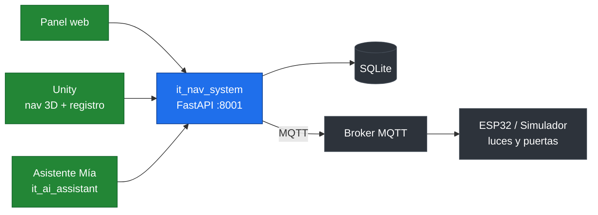
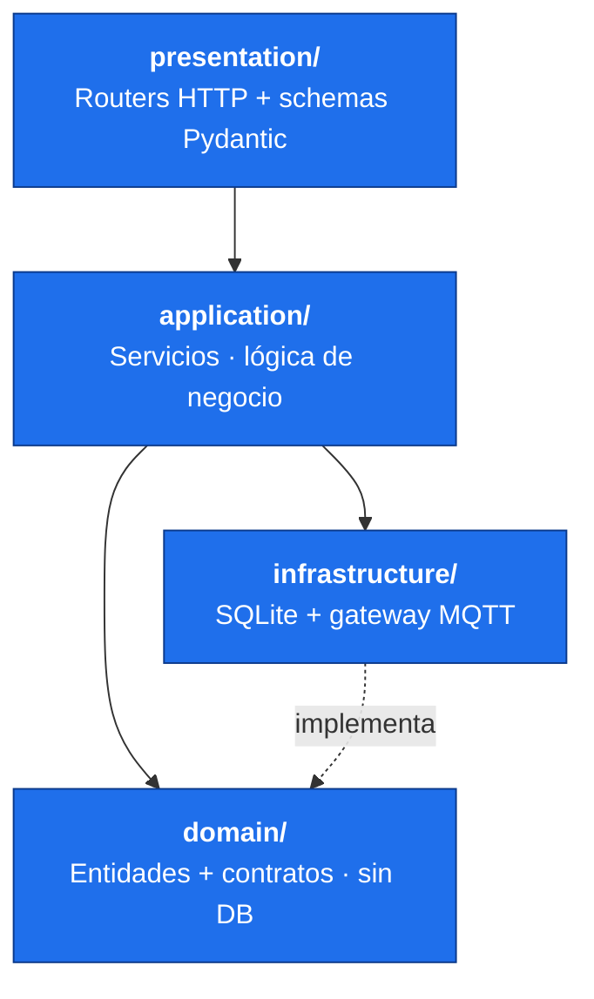

# it_nav_system — sistema de navegación y domótica

Microservicio de **navegación domótica** del proyecto **Inclusive Tech**, un sistema domótico accesible desarrollado como proyecto de grado en la Fundación Universitaria Konrad Lorenz. Trabaja junto al asistente de voz **Mía**.

Gestiona el **grafo de nodos** (habitaciones y puntos de paso) de una casa inteligente, permite personalizar nombres y **alias de voz** desde un panel web, controla los **dispositivos físicos** (luces y puertas) a través de **MQTT**, y sincroniza toda esa configuración con la simulación 3D en Unity y una maqueta física con placas ESP32.

Expone una API REST (FastAPI + SQLite) consumida por tres clientes: el **panel web** de administración (que el propio backend sirve), el proyecto de **Unity** (navegación 3D y registro de nodos) y el microservicio del **asistente de voz** (`it_ai_assistant`), que resuelve comandos hablados a nodos concretos del grafo.

---

## Tabla de contenidos

- [Características](#características)
- [Arquitectura del sistema](#arquitectura-del-sistema)
- [Arquitectura del backend](#arquitectura-del-backend)
- [Tecnologías](#tecnologías)
- [Requisitos previos](#requisitos-previos)
- [Instalación](#instalación)
- [Configuración (archivo `.env`)](#configuración-archivo-env)
- [Ejecución](#ejecución)
- [El panel web](#el-panel-web)
- [El simulador de dispositivos](#el-simulador-de-dispositivos)
- [Pruebas](#pruebas)
- [Endpoints de la API](#endpoints-de-la-api)
- [Integración con Unity](#integración-con-unity)
- [Decisiones de arquitectura](#decisiones-de-arquitectura)
- [Estructura del proyecto](#estructura-del-proyecto)
- [Contexto académico](#contexto-académico)

---

## Características

- **Grafo de la casa**: nodos (habitaciones y waypoints) y aristas que los conectan.
- **Nombres y alias de voz** editables por el usuario desde el panel web (hasta 5 alias por nodo).
- **Control de dispositivos** (luces y puertas) vía **MQTT** hacia las placas ESP32.
- **Seguimiento de órdenes**: confirma cada orden con el estado que devuelve el hardware dentro de un tiempo límite, y reporta las que no responden.
- **Panel web servido por el propio backend** (HTML/CSS/JS sin frameworks ni build).
- **Simulador de placa ESP32** incluido, para probar luces y puertas sin hardware.
- **Arquitectura limpia por capas** (presentation / application / domain / infrastructure).
- **Separación de roles**: endpoints de desarrollador protegidos con clave; endpoints de usuario abiertos en local.

---

## Arquitectura del sistema



El backend es la **única fuente de verdad** sobre qué nodos existen, cómo se llaman y cómo están conectados. Los tres clientes lo consultan; el control físico sale por MQTT hacia las placas ESP32 (o el simulador).

---

## Arquitectura del backend

Arquitectura limpia por capas, con inyección de dependencias de FastAPI. El dominio no conoce la base de datos: la infraestructura **implementa** los contratos definidos en el dominio.



**Patrones de diseño aplicados:** Repository, Dependency Injection, Factory Method (construcción validada de entidades), Singleton (conexión a base de datos), Facade (servicios y cliente HTTP del frontend) y DTO (schemas Pydantic).

---

## Tecnologías

| Componente | Tecnología |
|---|---|
| Framework web | FastAPI + Uvicorn |
| Base de datos | SQLite |
| Mensajería con dispositivos | MQTT (paho-mqtt) |
| Validación de datos | Pydantic v2 |
| Configuración | python-dotenv |
| Panel web | HTML + CSS + JavaScript (sin frameworks) |
| Pruebas | pytest |
| Lenguaje | Python |

---

## Requisitos previos

- **Python 3.13**.
- Git.
- Un **broker MQTT** accesible (p. ej. Mosquitto) si vas a controlar dispositivos reales o el simulador. Puede desactivarse con `INCLUSIVE_MQTT_ENABLED=false`.
- Opcional: la extensión **SQLite Viewer** de VS Code para inspeccionar la base de datos.

---

## Instalación

```bash
# 1. Clonar el repositorio
git clone https://github.com/Gadex1506/it_nav_system.git
cd it_nav_system/backend

# 2. Crear y activar el entorno virtual
python -m venv venv

# Windows
venv\Scripts\activate
# Linux / macOS
source venv/bin/activate

# 3. Instalar dependencias
pip install -r requirements.txt

# 4. Crear el archivo .env a partir de la plantilla
cp .env.example .env   # (Windows: copy .env.example .env)
```

Luego rellena el `.env` con los valores reales (ver abajo).

---

## Configuración (archivo `.env`)

El `.env` vive en `backend/` y **no se sube a git**. La plantilla está en `backend/.env.example`.

| Variable | Obligatoria | Por defecto | Descripción |
|---|---|---|---|
| `INCLUSIVE_DEV_KEY` | **Sí** | — | Clave de los endpoints de desarrollador (cabecera `X-Dev-Key`). Mínimo 16 caracteres. |
| `INCLUSIVE_MQTT_PASSWORD` | **Sí** (si MQTT activo) | — | Clave del usuario `inclusive_backend` del broker MQTT (la usa el backend). |
| `INCLUSIVE_ESP32_PASSWORD` | **Sí** (para el simulador) | — | Clave del usuario `inclusive_esp32` del broker (la usan el simulador y las placas ESP32). |
| `INCLUSIVE_MQTT_ENABLED` | No | `true` | `false` desactiva por completo la pasarela MQTT. |
| `INCLUSIVE_MQTT_HOST` | No | `localhost` | Dirección del broker MQTT. |
| `INCLUSIVE_MQTT_PORT` | No | `1883` | Puerto del broker MQTT. |
| `INCLUSIVE_MQTT_USER` | No | `inclusive_backend` | Usuario MQTT del backend. |
| `INCLUSIVE_API_HOST` | No | `127.0.0.1` | Host del servidor HTTP. Solo cambiar a `0.0.0.0` para exponerlo en la red (no recomendado). |

> El puerto HTTP es **8001** (fijo en `app/config.py`).

---

## Ejecución

Desde `backend/`, con el entorno virtual activo. Hay dos formas:

```bash
# Desarrollo (recarga en caliente)
uvicorn app.main:app --reload --port 8001

# Como lo arranca Unity / para el build (sin recarga)
python -m app.main
```

Al arrancar correctamente verás:

```
Iniciando la API del Sistema de Navegacion de Inclusive Tech - Asistente: Mia
Base de datos inicializada correctamente.
INFO:     Uvicorn running on http://127.0.0.1:8001
INFO:     Application startup complete.
```

- **Panel web:** `http://127.0.0.1:8001/`
- **Documentación interactiva (Swagger):** `http://127.0.0.1:8001/docs`
- **Health check:** `http://127.0.0.1:8001/health`

> Para la demo y el build deja `reload=False` (ya está así en `app/main.py`): el modo `--reload` lanza un proceso recargador aparte que complica el apagado que hace Unity al cerrar.

---

## El panel web

El panel web **lo sirve el propio backend** (archivos de `frontend/` montados en la raíz). No se abre por doble clic: con el servidor corriendo, entra a `http://127.0.0.1:8001/`.

Páginas:

- **`/` (index):** pantalla central. Enlaza al panel del hogar y al panel de desarrollo. Si Unity abre la raíz con `#key=...`, redirige automáticamente al panel del hogar conservando la clave.
- **`panel.html` — Panel del hogar:** pestañas **Hogar** (nodos, renombrar, alias de voz) y **Usuarios**.
- **`dev.html` — Panel de desarrollo:** gestión de casas y dispositivos. Requiere la clave de desarrollador, que `index.html` valida y guarda antes de redirigir.

Desde el panel del hogar el usuario puede ver los nodos, renombrar una habitación (`display_name`) y agregar o eliminar alias de voz (hasta 5 por nodo). Esos cambios se reflejan en Unity sin reiniciar la escena, gracias al *polling* de `RoomNameBootstrap`.

---

## El simulador de dispositivos

Para probar luces y puertas sin hardware real, el repo incluye un simulador de la placa ESP32. Desde `backend/`, con el broker MQTT corriendo:

```bash
# Simula una placa con una luz/puerta por cada dispositivo registrado en el backend
python -m simulator

# Solo dispositivos concretos, sin consultar al backend
python -m simulator --lights light_sala --doors door_banio

# Opciones útiles
python -m simulator --door-travel-ms 3000   # servo lento
python -m simulator --latency-ms 1500        # hardware lento
```

`Ctrl + C` simula un corte de energía: el proceso termina sin despedirse y el broker publica `offline` por la placa (Last Will).

---

## Pruebas

Desde `backend/`, con el entorno virtual activo:

```bash
pytest -v
```

Los tests usan una base de datos SQLite temporal y aislada (ver `tests/conftest.py`), por lo que **nunca tocan tus datos reales**.

---

## Endpoints de la API

Documentación completa e interactiva en `/docs` con el servidor corriendo. Los endpoints de **desarrollador** requieren la cabecera `X-Dev-Key`.

### Sistema

| Método | Ruta | Descripción |
|---|---|---|
| `GET` | `/health` | Verifica que la API está activa. |

### Desarrollador — `/dev` (requiere `X-Dev-Key`)

| Método | Ruta | Descripción |
|---|---|---|
| `POST` | `/dev/houses` | Crea una casa. |
| `GET` | `/dev/houses` | Lista las casas. |
| `GET` | `/dev/houses/overview` | Resumen de casas e indica la casa activa. |
| `DELETE` | `/dev/houses/{house_id}` | Elimina una casa. |
| `POST` | `/dev/nodes` | Crea un nodo (habitación o waypoint). |
| `DELETE` | `/dev/nodes/{node_id}` | Elimina un nodo. |
| `PATCH` | `/dev/nodes/{node_id}/physical-position` | Actualiza la posición física en la maqueta. |
| `POST` | `/dev/edges` | Conecta dos nodos del grafo. |
| `DELETE` | `/dev/edges/{edge_id}` | Elimina una conexión. |
| `POST` | `/dev/nodes/{node_id}/aliases` | Agrega un alias de voz. |
| `POST` | `/dev/devices` | Registra un dispositivo (luz o puerta). |
| `GET` | `/dev/devices` | Lista dispositivos (por `house_id` o `node_id`). |
| `PATCH` | `/dev/devices/{device_id}/display-name` | Renombra un dispositivo. |
| `DELETE` | `/dev/devices/{device_id}` | Elimina un dispositivo. |

### Panel de usuario — `/user`

| Método | Ruta | Descripción |
|---|---|---|
| `GET` | `/user/nodes` | Lista los nodos activos de la casa. |
| `GET` | `/user/nodes/{node_id}` | Detalle de un nodo. |
| `PATCH` | `/user/nodes/{node_id}/display-name` | Renombra un nodo. |
| `POST` | `/user/nodes/{node_id}/aliases` | Agrega un alias de voz. |
| `DELETE` | `/user/nodes/{node_id}/aliases/{alias_id}` | Elimina un alias. |

### Dispositivos de usuario — `/user/devices`

| Método | Ruta | Descripción |
|---|---|---|
| `POST` | `/user/devices/lights` | Enciende/apaga todas las luces de la casa. |
| `POST` | `/user/devices/lights/{device_key}` | Controla una luz. |
| `POST` | `/user/devices/doors/{device_key}` | Abre/cierra una puerta. |
| `GET` | `/user/devices/orders/problems` | Órdenes que no se confirmaron a tiempo. |

### Pasarela MQTT (desarrollador) — `/dev/gateway`

| Método | Ruta | Descripción |
|---|---|---|
| `POST` | `/dev/gateway/lights/{device_key}` | Envía una orden de luz por MQTT. |
| `POST` | `/dev/gateway/doors/{device_key}` | Envía una orden de puerta por MQTT. |
| `GET` | `/dev/gateway/status` | Estado de la pasarela MQTT. |
| `GET` | `/dev/gateway/devices/{device_key}/status` | Estado de un dispositivo. |
| `GET` | `/dev/gateway/orders/problems` | Problemas de órdenes recientes. |

---

## Integración con Unity

Este servicio es uno de los tres procesos que la app de Unity levanta automáticamente al arrancar (vía su `ProcessManager`). El contrato que cumple:

- **Arranque:** `python -m app.main` desde la carpeta del backend (con el `python.exe` del venv).
- **Puerto:** `8001`.
- **Health check:** Unity hace `GET http://127.0.0.1:8001/health` y lo da por listo cuando responde `2xx`. **Timeout de arranque: 30 s.**
- **Variables inyectadas por Unity:** `PYTHONUNBUFFERED=1` y `PYTHONUTF8=1`.
- **Apagado:** Unity termina el proceso de forma forzada (árbol completo).

El proyecto de Unity consume el backend en dos momentos:

1. **Registro de nodos (herramienta de desarrollador):** desde el Inspector de cada `NavigationNode`, un botón lo registra contra `POST /dev/nodes`, capturando su posición y tipo (`room`/`waypoint`).
2. **Sincronización de nombres (runtime):** `RoomNameBootstrap` consulta `GET /user/nodes` al iniciar la escena y repite la consulta periódicamente (*polling*) para reflejar los cambios hechos en el panel web sin reiniciar.

Configuración en Unity: crear un asset `NavigationConfig` (`Assets > Create > Inclusive Tech > Navigation Config`) con el host y puerto del backend, y asignarlo en el componente `RoomNameBootstrap` de la escena.

**Botón "Panel web" del HUD de la casa:** abre `http://127.0.0.1:8001/` (la raíz que sirve este backend). Unity puede añadir `#key=...` al final para entrar directo al panel del hogar.

> **MQTT:** `ProcessManager` arranca solo este servicio Python, **no** un broker MQTT. Si vas a controlar dispositivos (reales o el simulador), el broker debe estar corriendo aparte, o desactiva MQTT con `INCLUSIVE_MQTT_ENABLED=false`.

---

## Decisiones de arquitectura

- **Multi-casa a nivel de datos, una casa activa en operación:** el modelo soporta varias casas, pero cada instalación opera con una **casa activa** que el backend resuelve (visible en `GET /dev/houses/overview`). Permite escalar a multiusuario en el futuro sin refactorizar el dominio.
- **`internal_name` vs `display_name`:** el nombre técnico de un nodo (`internal_name`) es inmutable y solo lo define el desarrollador desde Unity. El nombre visible (`display_name`) y los alias los edita el usuario desde el panel, y son los únicos que compiten en el reconocimiento de voz.
- **El dominio no depende de la base de datos:** la infraestructura implementa los contratos del dominio; cambiar de SQLite a otro motor no tocaría la lógica de negocio.
- **Instalación local, no SaaS:** cada instalación tiene su propia base de datos SQLite aislada. No hay una base de datos central compartida.

---

## Estructura del proyecto

```
it_nav_system/
├── backend/
│   ├── app/
│   │   ├── domain/            # Entidades y contratos (modelos, interfaces, eventos)
│   │   ├── application/       # Servicios: nodos, casas, dispositivos, seguimiento de órdenes
│   │   ├── infrastructure/    # SQLite (conexión, schema, repositorios) + gateway MQTT
│   │   ├── presentation/      # Routers (dev, user, gateway, user_device) + schemas + security
│   │   ├── config.py          # Constantes centralizadas (puerto, MQTT, dispositivos...)
│   │   └── main.py            # Punto de entrada FastAPI (sirve también el panel)
│   ├── simulator/             # Simulador de la placa ESP32 (python -m simulator)
│   ├── data/                  # Base de datos SQLite
│   ├── tests/                 # Tests de integración (pytest)
│   ├── requirements.txt
│   └── .env.example
│
└── frontend/                  # Panel web (lo sirve el backend)
    ├── index.html             # Pantalla central
    ├── panel.html             # Panel del hogar (Hogar + Usuarios)
    ├── dev.html               # Panel de desarrollo (requiere clave)
    ├── css/                   # base, home, hub, users, dev
    ├── js/                    # home/, dev/, hub/, users/, shared/
    └── assets/
```

---

## Contexto académico

Proyecto de grado **Panitas: Inclusive Tech** — Fundación Universitaria Konrad Lorenz.
Sistema domótico accesible compuesto por el sistema de navegación (`it_nav_system`), el asistente de voz (`it_ai_assistant`), la palabra de activación (`it_wake_word`) y el reconocimiento facial, integrados en la aplicación de Unity `InclusiveTech_SmartHome`. Este módulo es la fuente de verdad del grafo de la casa y el puente hacia los dispositivos físicos.